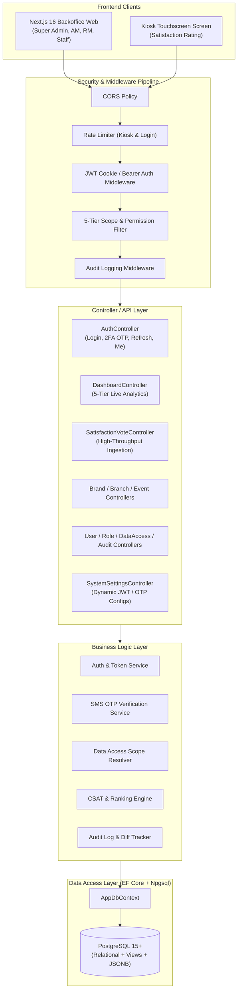
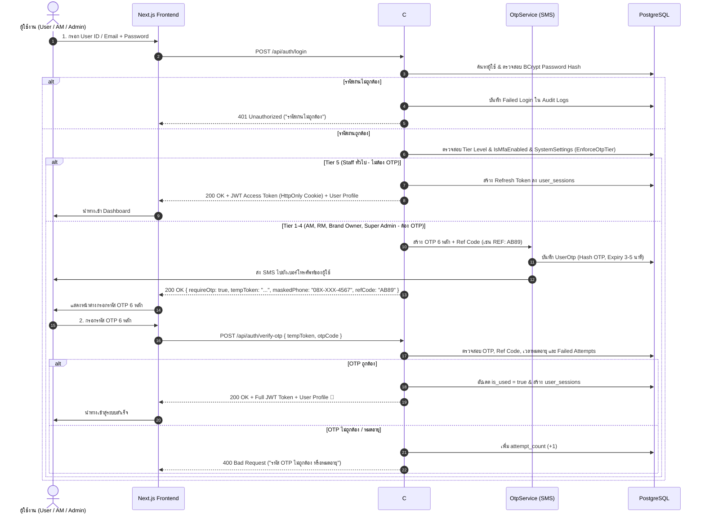
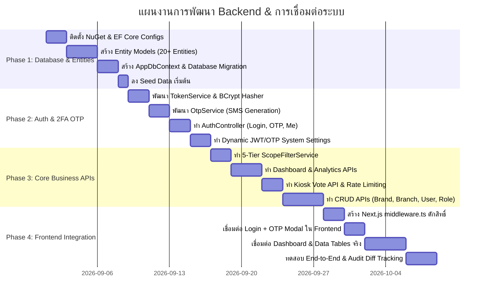

# 📋 Backend Architecture & Implementation Plan (`BackendPlan.md`)

> **Enterprise CSAT & Multi-Tier Analytics Platform (Satisfaction Management)**  
> **Technology Stack:** C# ASP.NET Core (.NET 10) | Entity Framework Core (Npgsql) | PostgreSQL 15+ | Custom JWT + 2FA SMS OTP | Next.js 16 (Turbopack)

---

## 📑 สารบัญ (Table of Contents)

1. [ภาพรวมสถาปัตยกรรมและเทคโนโลยี (Architecture Overview)](#1-ภาพรวมสถาปัตยกรรมและเทคโนโลยี-architecture-overview)
2. [โครงสร้างไดเรกทอรีโปรเจกต์ .NET 10 (Project Structure)](#2-โครงสร้างไดเรกทอรีโปรเจกต์-net-10-project-structure)
3. [ระบบฐานข้อมูลและ Entity Framework Core (Database & EF Core)](#3-ระบบฐานข้อมูลและ-entity-framework-core-database--ef-core)
4. [ระบบยืนยันตัวตนและความปลอดภัย (Authentication, JWT & SMS OTP)](#4-ระบบยืนยันตัวตนและความปลอดภัย-authentication-jwt--sms-otp)
5. [ระบบควบคุมสิทธิ์ 5 ระดับชั้น (5-Tier Data Access Scope Engine)](#5-ระบบควบคุมสิทธิ์-5-ระดับชั้น-5-tier-data-access-scope-engine)
6. [การตั้งค่าระบบความปลอดภัยแบบไดนามิก (Dynamic Security Settings)](#6-การตั้งค่าระบบความปลอดภัยแบบไดนามิก-dynamic-security-settings)
7. [ข้อกำหนดและรายการ API Endpoints (RESTful API Specification)](#7-ข้อกำหนดและรายการ-api-endpoints-restful-api-specification)
8. [แผนการเชื่อมต่อกับ Next.js Frontend (Frontend Integration Plan)](#8-แผนการเชื่อมต่อกับ-nextjs-frontend-frontend-integration-plan)
9. [แผนขั้นตอนการพัฒนาแบบแบ่งเฟส (Phase-by-Phase Roadmap)](#9-แผนขั้นตอนการพัฒนาแบบแบ่งเฟส-phase-by-phase-roadmap)

---

## 1. ภาพรวมสถาปัตยกรรมและเทคโนโลยี (Architecture Overview)

ระบบหลังบ้านออกแบบตามมาตรฐาน **Clean / Layered Architecture** โดยใช้ C# .NET 10 Web API ทำหน้าที่เป็นศูนย์กลางความปลอดภัย (Single Source of Truth) เพื่อรองรับการทำงานร่วมกับตู้ Kiosk หน้าร้าน และระบบ Backoffice ของผู้บริหาร 5 ระดับ



---

## 2. โครงสร้างไดเรกทอรีโปรเจกต์ .NET 10 (Project Structure)

จัดโครงสร้างแบบ **Feature-Driven & Layered** ภายในโฟลเดอร์ `Backend/`:

```
Backend/
├── Common/                          # ค่าคงที่ คลาสผลลัพธ์มาตรฐาน และ Enums
│   ├── ApiResponse.cs               # Generic Wrapper: ApiResponse<T>
│   ├── PagedResult.cs               # Pagination Wrapper: PagedResult<T>
│   ├── Enums.cs                     # StatusType, SentimentType, TierLevel, KioskStatus
│   └── AppConstants.cs              # System Defaults & Policy Names
│
├── Entities/                        # Database Entity Models (Mapping กับ schema.md)
│   ├── BaseEntity.cs                # Id, CreatedAt, UpdatedAt, CreatedBy, UpdatedBy
│   ├── Region.cs & Province.cs      # โครงสร้างภูมิศาสตร์
│   ├── Brand.cs & Branch.cs         # แบรนด์และสาขา
│   ├── BranchBrand.cs               # Junction: Branch <-> Brand
│   ├── Kiosk.cs                     # ตู้ประเมินหน้าร้าน
│   ├── SystemModule.cs              # รายการโมดูลระบบ
│   ├── Role.cs                      # บทบาทผู้ใช้
│   ├── RolePermission.cs            # สิทธิ์รายโมดูล (View, Create, Update, Delete, Export)
│   ├── User.cs                      # ข้อมูลผู้ใช้งาน + Phone + IsMfaEnabled
│   ├── UserOtp.cs                   # ตารางเก็บรหัส OTP ชั่วคราว + Ref Code
│   ├── UserSession.cs               # JWT Refresh Token Storage
│   ├── UserPermission.cs            # Grid Dashboard 5 ระดับ
│   ├── UserBrandScope.cs            # User Scope: Brands
│   ├── UserRegionScope.cs           # User Scope: Regions
│   ├── UserProvinceScope.cs         # User Scope: Provinces
│   ├── UserBranchScope.cs           # User Scope: Branches
│   ├── SatisfactionVote.cs          # ธุรกรรมผลโหวตความพึงพอใจ
│   ├── SatisfactionConfig.cs        # การตั้งค่าหน้า Kiosk
│   ├── Event.cs & EventCategory.cs  # ปฏิทินกิจกรรมและแคมเปญ
│   ├── EventTargetBranch.cs         # Junction: Event <-> Branches
│   ├── Notification.cs              # การแจ้งเตือนระบบ
│   ├── AuditLog.cs                  # ประวัติการทำงาน
│   ├── AuditDiffDetail.cs           # รายละเอียด Visual Diff
│   ├── ApiServiceHealth.cs          # สถานะ Microservices Uptime
│   └── SystemSetting.cs             # Key-Value Configs (JWT Expiry, OTP Expiry)
│
├── Data/                            # Database Context & Migrations
│   ├── AppDbContext.cs              # EF Core DbContext + Fluent API Mapping
│   ├── Configurations/              # EntityTypeConfiguration แยกราย Entity
│   └── Seeds/                       # Initial Seed Data (Admin, Roles, Modules, Brands)
│
├── DTOs/                            # Data Transfer Objects (Request / Response)
│   ├── Auth/                        # LoginRequest, VerifyOtpRequest, TokenResponse, UserProfileDto
│   ├── Dashboard/                   # CsatOverviewDto, TrendChartDto, TierGridDto, LiveFeedDto
│   ├── Organization/                # BrandDtos, BranchDtos, KioskDtos
│   ├── Users/                       # CreateUserDto, UpdateUserDto, DataAccessScopeDto
│   ├── Events/                      # EventDtos, NotificationDtos
│   ├── Audit/                       # AuditLogQueryDto, ServiceHealthDto
│   └── Settings/                    # GeneralSettingsDto, SecuritySettingsDto, KioskSettingsDto
│
├── Services/                        # Business Logic Implementation
│   ├── Interfaces/                  # Interface สัญญาการทำงาน
│   ├── AuthService.cs               # ตรวจสอบรหัสผ่าน, ออก JWT Token, จัดการ Refresh Token
│   ├── OtpService.cs                # สร้าง OTP 6 หลัก, นับเวลาหมดอายุ, ส่ง SMS (Mock/Gateway)
│   ├── TokenService.cs              # สร้าง/ตรวจสอบ JWT Claims
│   ├── ScopeFilterService.cs        # คัดกรองข้อมูลตามสิทธิ์ 5-Tier ใน IQueryable
│   ├── DashboardService.cs          # สรุปคะแนน CSAT, Realtime Feed, คำนวณ Tier Grids
│   ├── SatisfactionVoteService.cs   # บันทึกโหวต + ป้องกัน Duplicate Vote
│   ├── UserService.cs               # จัดการผู้ใช้ + กำหนด Scope
│   ├── AuditService.cs              # บันทึก Audit Log อัตโนมัติพร้อม Track Diff
│   └── SystemSettingsService.cs     # อ่าน/บันทึกการตั้งค่าระบบ (Dynamic JWT / OTP)
│
├── Middlewares/                     # Custom HTTP Middlewares & Filters
│   ├── ExceptionHandlingMiddleware.cs # จัดการ Error กลาง ส่งโครงสร้าง JSON ที่สม่ำเสมอ
│   ├── AuditLoggingMiddleware.cs      # บันทึก Request/Response ของ Endpoint สำคัญ
│   └── PermissionAuthorizeAttribute.cs # Custom Filter: [HasPermission("MODULE", "ACTION")]
│
├── Controllers/                     # RESTful API Endpoints
│   ├── AuthController.cs            # /api/auth (Login, VerifyOtp, Refresh, Me)
│   ├── DashboardController.cs       # /api/dashboard (Stats, Trends, Grids, Feed)
│   ├── SatisfactionController.cs    # /api/satisfaction (Vote, Config)
│   ├── BrandsController.cs          # /api/brands
│   ├── BranchesController.cs        # /api/branches
│   ├── UsersController.cs           # /api/users
│   ├── RolesController.cs           # /api/roles
│   ├── DataAccessController.cs      # /api/data-access
│   ├── EventsController.cs          # /api/events
│   ├── NotificationsController.cs   # /api/notifications
│   ├── AuditController.cs           # /api/audit
│   └── SystemSettingsController.cs  # /api/settings (General, Security, Kiosk)
│
├── appsettings.json                 # ConnectionStrings, JWT Secret, App Defaults
├── appsettings.Development.json
├── Program.cs                       # DI Container, Pipeline Config, Swagger
└── Backend.csproj                   # NuGet Packages Definition
```

---

## 3. ระบบฐานข้อมูลและ Entity Framework Core (Database & EF Core)

### 3.1 NuGet Packages ที่ต้องติดตั้ง
```xml
<ItemGroup>
  <PackageReference Include="Npgsql.EntityFrameworkCore.PostgreSQL" Version="10.0.0-preview.*" />
  <PackageReference Include="Microsoft.EntityFrameworkCore.Design" Version="10.0.0-preview.*" />
  <PackageReference Include="Microsoft.EntityFrameworkCore.Tools" Version="10.0.0-preview.*" />
  <PackageReference Include="BCrypt.Net-Next" Version="4.0.3" />
  <PackageReference Include="Microsoft.AspNetCore.Authentication.JwtBearer" Version="10.0.0-preview.*" />
  <PackageReference Include="System.IdentityModel.Tokens.Jwt" Version="8.6.0" />
</ItemGroup>
```

### 3.2 การ Mapping Enum และ Triggers ใน `AppDbContext.cs`
- กำหนด `HasPostgresEnum<StatusType>()`, `HasPostgresEnum<SentimentType>()`, `HasPostgresEnum<TierLevelType>()`
- ใช้งาน `AuditDbContext` เพื่อดักจับ `ChangeTracker.Entries()` และบันทึก `AuditLogs` + `AuditDiffDetails` อัตโนมัติเมื่อเกิดการ INSERT, UPDATE, DELETE

---

## 4. ระบบยืนยันตัวตนและความปลอดภัย (Authentication, JWT & SMS OTP)

### 4.1 แผนภาพลำดับการทำงาน (2-Factor Authentication Flow)



### 4.2 โครงสร้าง JWT Token Payload
```json
{
  "sub": "b8a531e2-38ef-41a4-b0cf-5b65103a89e1",
  "email": "somchai.am@crg.co.th",
  "name": "สมชาย บริหารสาขา",
  "role": "Area Manager",
  "tier": "Area Manager",
  "permissions": [
    "DASHBOARD:VIEW",
    "BRANCH:VIEW",
    "BRANCH:UPDATE",
    "KIOSK:VIEW"
  ],
  "scopes": {
    "brandIds": ["uuid-kfc"],
    "provinceIds": ["uuid-chiangmai"],
    "branchIds": ["uuid-branch-01", "uuid-branch-02"]
  },
  "exp": 1756540800
}
```

---

## 5. ระบบควบคุมสิทธิ์ 5 ระดับชั้น (5-Tier Data Access Scope Engine)

Backend จะมี `ScopeFilterService` เพื่อทำหน้าที่แนบ Query Filter ใน Entity Framework Core แบบอัตโนมัติ:

```csharp
// ตัวอย่าง Logic การคัดกรองข้อมูลตามสิทธิ์ 5 ระดับ
public IQueryable<SatisfactionVote> ApplyUserScope(IQueryable<SatisfactionVote> query, CurrentUser user)
{
    return user.TierLevel switch
    {
        TierLevelType.SuperAdmin => query, // เห็นทุกอย่าง
        TierLevelType.BrandOwner => query.Where(v => user.ScopedBrandIds.Contains(v.BrandId)),
        TierLevelType.RegionalManager => query.Where(v => user.ScopedRegionIds.Contains(v.Branch.Province.RegionId)),
        TierLevelType.AreaManager => query.Where(v => user.ScopedProvinceIds.Contains(v.Branch.ProvinceId)),
        TierLevelType.BranchStaff => query.Where(v => user.ScopedBranchIds.Contains(v.BranchId)),
        _ => query.Where(v => false)
    };
}
```

---

## 6. การตั้งค่าระบบความปลอดภัยแบบไดนามิก (Dynamic Security Settings)

เปิดให้ผู้ดูแลระบบปรับแต่งค่าความปลอดภัยผ่านหน้าจอ **System Settings** บนเว็บ และบันทึกลงตาราง `system_settings` ใน PostgreSQL:

### ตารางการตั้งค่าความปลอดภัย (`system_settings` Key: `SECURITY_CONFIG`)
| พารามิเตอร์ | ค่าเริ่มต้น | รายละเอียด |
| :--- | :---: | :--- |
| `jwtExpiryDays` | `7` วัน | กำหนดอายุของ Session / Access Token (เช่น 1, 7, 15, 30 วัน) |
| `refreshTokenExpiryDays` | `30` วัน | กำหนดอายุของ Refresh Token สำหรับเข้าสู่ระบบต่อเนื่อง |
| `otpExpiryMinutes` | `5` นาที | ระยะเวลาหมดอายุของรหัส SMS OTP 6 หลัก |
| `enforceOtpTierLevel` | `Area Manager` | ระดับ Tier ขั้นต่ำที่ระบบจะบังคับใช้ OTP (AM, RM, Brand Owner, Super Admin) |
| `maxOtpFailedAttempts` | `3` ครั้ง | จำนวนครั้งที่อนุญาตให้กรอก OTP ผิดก่อนรหัสจะถูกยกเลิก |

> 💡 **การทำงาน:** เมื่อมีการอัปเดตค่าในเว็บ `SystemSettingsService` จะทำการ Refresh Cache ทันที ทำให้การ Login ครั้งถัดไปนำค่านวนวัน/นาทีใหม่ไปใช้โดยไม่ต้อง Restart Backend

---

## 7. ข้อกำหนดและรายการ API Endpoints (RESTful API Specification)

### 7.1 Authentication & Security (`/api/auth`)
| Method | Path | รายละเอียด | สิทธิ์ที่ต้องมี |
| :--- | :--- | :--- | :--- |
| `POST` | `/api/auth/login` | ตรวจสอบ User ID/Password (คืนค่า Token หรือขอ OTP) | Public |
| `POST` | `/api/auth/verify-otp` | ยืนยันรหัส OTP 6 หลักเพื่อรับ Full JWT Token | Public (ใช้ tempToken) |
| `POST` | `/api/auth/resend-otp` | ขอส่งรหัส OTP ใหม่อีกครั้ง | Public (Rate Limited) |
| `GET` | `/api/auth/me` | ดึงข้อมูล Profile, สิทธิ์ Module, และ Data Access Scope | Authenticated |
| `POST` | `/api/auth/refresh` | ต่ออายุ Access Token ด้วย Refresh Token | Authenticated |
| `POST` | `/api/auth/logout` | ยกเลิก Session และลบ Cookie | Authenticated |

### 7.2 Dashboard & Live Analytics (`/api/dashboard`)
| Method | Path | รายละเอียด | สิทธิ์ที่ต้องมี |
| :--- | :--- | :--- | :--- |
| `GET` | `/api/dashboard/stats` | สรุปคะแนน CSAT รวม, จำนวนโหวต, เปอร์เซ็นต์ความพึงพอใจ | `DASHBOARD:VIEW` (Scoped) |
| `GET` | `/api/dashboard/trend` | ข้อมูลกราฟแนวโน้มความพึงพอใจ (รายชั่วโมง/รายวัน/รายเดือน) | `DASHBOARD:VIEW` (Scoped) |
| `GET` | `/api/dashboard/tier-grid` | ตารางเปรียบเทียบผลงานตาม Tier (Brand/Region/Province/Branch) | `DASHBOARD:VIEW` (Scoped) |
| `GET` | `/api/dashboard/live-feed` | ผลการประเมินล่าสุดแบบเรียลไทม์ (Live Feed) | `DASHBOARD:VIEW` (Scoped) |
| `GET` | `/api/dashboard/kiosks-status`| ตรวจสอบสถานะการเชื่อมต่อตู้ Kiosk ประจำสาขา | `DASHBOARD:VIEW` (Scoped) |

### 7.3 Kiosk Satisfaction Voting (`/api/satisfaction`)
| Method | Path | รายละเอียด | สิทธิ์ที่ต้องมี |
| :--- | :--- | :--- | :--- |
| `POST` | `/api/satisfaction/vote` | บันทึกคะแนนความพึงพอใจ (Happy, Neutral, Sad) | Public (Kiosk API Key) |
| `GET` | `/api/satisfaction/config` | ดึงการตั้งค่าหน้าจอ Kiosk (หัวข้อ, ขนาดฟอนต์, เวลาปิด) | Public |

### 7.4 Master Data Management
| Module | Base Path | การทำงานหลัก |
| :--- | :--- | :--- |
| **Brands** | `/api/brands` | `GET`, `POST`, `PUT`, `DELETE` จัดการแบรนด์และโลโก้ |
| **Branches** | `/api/branches` | `GET`, `POST`, `PUT`, `DELETE` จัดการสาขาและตู้ Kiosk |
| **Users** | `/api/users` | `GET`, `POST`, `PUT`, `DELETE` ผู้ใช้งานและกำหนดเบอร์โทร |
| **Data Access** | `/api/data-access` | `GET`, `PUT` กำหนดขอบเขต 5-Tier Scope รายบุคคล |
| **Roles** | `/api/roles` | `GET`, `POST`, `PUT`, `DELETE` จัดการเมทริกซ์สิทธิ์โมดูล |
| **Events** | `/api/events` | `GET`, `POST`, `PUT`, `DELETE` ปฏิทินกิจกรรมและการซ่อมบำรุง |
| **Notifications** | `/api/notifications` | `GET`, `PUT /read`, `DELETE` กล่องแจ้งเตือนและการแจ้งเตือนด่วน |
| **Audit Logs** | `/api/audit` | `GET /logs`, `GET /health` ประวัติการกระทำและสถานะ Uptime |
| **Settings** | `/api/settings` | `GET`, `PUT` การตั้งค่าทั่วไป, ความปลอดภัย (JWT/OTP), Kiosk |

---

## 8. แผนการเชื่อมต่อกับ Next.js Frontend (Frontend Integration Plan)

### 8.1 การป้องกัน Route ใน Frontend (`middleware.ts`)
```typescript
// Next.js Middleware ตรวจสอบ JWT Cookie ก่อนเข้าถึงหน้า Dashboard/Admin
import { NextResponse } from 'next/server';
import type { NextRequest } from 'next/server';

export function middleware(request: NextRequest) {
  const token = request.cookies.get('satisfaction_access_token')?.value;
  const { pathname } = request.nextUrl;

  // 1. ถ้ายังไม่ Login แล้วพยายามเข้าหน้า Admin -> Redirect ไป /login
  if (!token && !pathname.startsWith('/login') && !pathname.startsWith('/satisfaction')) {
    return NextResponse.redirect(new URL('/login', request.url));
  }

  // 2. ถ้า Login แล้วแต่เข้าหน้า /login -> Redirect ไป /dashboard
  if (token && pathname.startsWith('/login')) {
    return NextResponse.redirect(new URL('/dashboard', request.url));
  }

  return NextResponse.next();
}

export const config = {
  matcher: ['/((?!api|_next/static|_next/image|favicon.ico).*)'],
};
```

### 8.2 การปรับปรุง UI หน้าจอ Frontend
1. **หน้าจอ Login (`Screens/Authentication/Login/page.tsx`)**:
   - เพิ่ม Modal รับรหัส OTP 6 หลัก พร้อมช่องนับเวลาถอยหลัง (3-5 นาที) และปุ่มขอรหัสใหม่
2. **หน้าจอ User Management (`Screens/Admin/UserManagement/page.tsx`)**:
   - เพิ่มช่องกรอกเบอร์โทรศัพท์ (Phone Number)
   - เพิ่มสวิตช์เปิด-ปิดการบังคับใช้ OTP รายบุคคล
3. **หน้าจอ System Settings (`Screens/Admin/SystemSettings/page.tsx`)**:
   - เพิ่มแท็บ **"Security & Access"** ให้เลือกจำนวนวันหมดอายุของ JWT (เช่น 1, 7, 30 วัน) และเวลาหมดอายุ OTP

---

## 9. แผนขั้นตอนการพัฒนาแบบแบ่งเฟส (Phase-by-Phase Roadmap)



---

## 🎯 สรุปผลลัพธ์ที่ได้จากแผนงานนี้

1. **ความปลอดภัยระดับสูง**: รหัสผ่านถูกเข้ารหัสด้วย BCrypt, Session ถูกป้องกันด้วย JWT HttpOnly Cookie, และมี SMS OTP คุ้มครองผู้ใช้ระดับ AM ขึ้นไป
2. **ยืดหยุ่นสูงจากหน้าเว็บ**: ผู้ดูแลระบบสามารถเปลี่ยนอายุของ JWT (จำนวนวัน) และอายุ OTP จากหน้า System Settings ได้ทันที
3. **โครงสร้าง 5 ระดับสมบูรณ์แบบ**: Data Access Scope ถูกดักจับและคัดกรองตั้งแต่ระดับ Database Query ไม่มีการรั่วไหลของข้อมูลข้าม Brand/Region/Province/Branch
4. **พร้อมต่อยอดสู่ Production**: โค้ดถูกจัดระเบียบตามมาตรฐาน Clean Architecture ใน .NET 10 รองรับทั้ง Kiosk ความเร็วสูง และ Dashboard วิเคราะห์ข้อมูลระดับองค์กร

