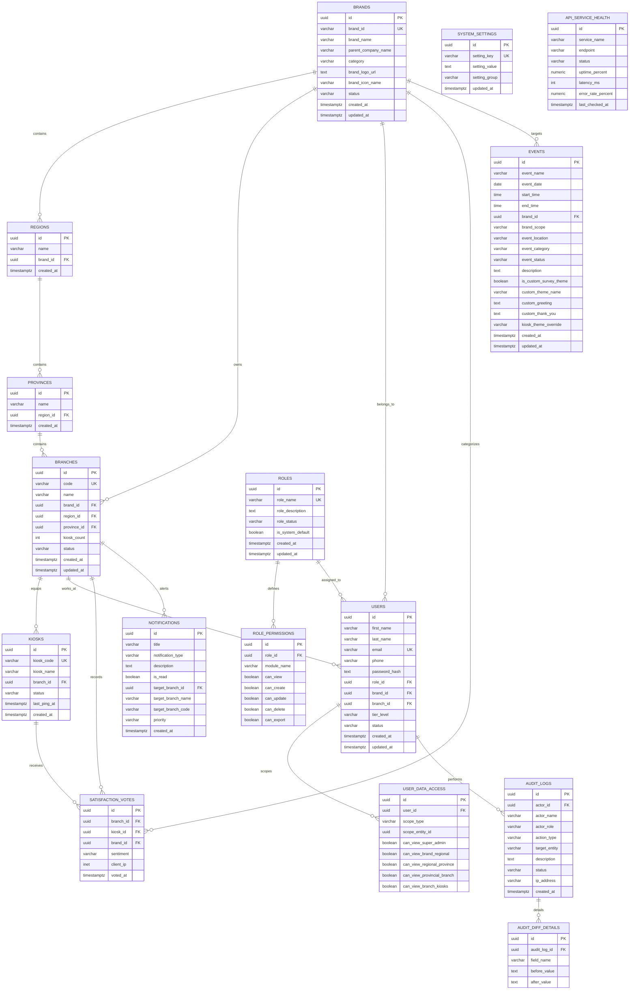

# 📊 Enterprise CSAT Platform - Database Design & Backend Integration (.NET / PostgreSQL)

เอกสารการออกแบบฐานข้อมูลเชิงสัมพันธ์ (**PostgreSQL**) และสถาปัตยกรรมเชื่อมต่อระบบหลังบ้านด้วย **C# ASP.NET Core (.NET 10) / Entity Framework Core (Npgsql)** สำหรับระบบประเมินความพึงพอใจลูกค้าและวิเคราะห์ข้อมูลหลายระดับชั้นองค์กร (**5-Tier Organizational Hierarchy**)

---

## 📑 สารบัญ (Table of Contents)
1. [สถาปัตยกรรมและการจัดโครงสร้างข้อมูล (Hierarchy Overview)](#1-สถาปัตยกรรมและการจัดโครงสร้างข้อมูล-hierarchy-overview)
2. [แผนภาพความสัมพันธ์ของข้อมูล (Entity Relationship Diagram - ERD)](#2-แผนภาพความสัมพันธ์ของข้อมูล-entity-relationship-diagram---erd)
3. [พจนานุกรมข้อมูล (PostgreSQL Data Dictionary)](#3-พจนานุกรมข้อมูล-postgresql-data-dictionary)
4. [สคริปต์สร้างฐานข้อมูล (PostgreSQL DDL Scripts)](#4-สคริปต์สร้างฐานข้อมูล-postgresql-ddl-scripts)
5. [การเชื่อมต่อและโครงสร้าง C# .NET Backend (EF Core & Npgsql)](#5-การเชื่อมต่อและโครงสร้าง-c-net-backend-ef-core--npgsql)
6. [การกำหนดสิทธิ์ 5-Tier Data Access & Query Optimization](#6-การกำหนดสิทธิ์-5-tier-data-access--query-optimization)

---

## 1. สถาปัตยกรรมและการจัดโครงสร้างข้อมูล (Hierarchy Overview)

ระบบรองรับโครงสร้างองค์กรแบบ 5 ลำดับขั้น:
```
👑 Tier 1: Super Admin         → ดูภาพรวมและเปรียบเทียบทุก Brand ในเครือ CRG
🍗 Tier 2: Brand Owner         → ดูภาพรวมของ Brand และเปรียบเทียบผลงานระดับ "Region (ภาค)"
📍 Tier 3: Regional Manager (RM) → เปรียบเทียบผลคะแนนระดับ "Province (จังหวัด)" ภายในภาค
🏙️ Tier 4: Area Manager (AM)     → เปรียบเทียบผลคะแนนระดับ "Branch (สาขา)" ภายในเขต/จังหวัด
🏪 Tier 5: Branch Staff        → ดูผลคะแนน Real-time, สถานะตู้ Kiosk และข้อเสนอแนะภายในสาขา
```

---

## 2. แผนภาพความสัมพันธ์ของข้อมูล (Entity Relationship Diagram - ERD)



---

## 3. พจนานุกรมข้อมูล (PostgreSQL Data Dictionary)

### 3.1 กลุ่มโครงสร้างองค์กร (Organization Structure)

#### ตาราง `brands`
| ชื่อคอลัมน์ | ประเภทข้อมูล | เงื่อนไข | คำอธิบาย |
|---|---|---|---|
| `id` | `UUID` | PK, DEFAULT gen_random_uuid() | รหัสหลักของแบรนด์ |
| `brand_id` | `VARCHAR(50)` | UNIQUE, NOT NULL | รหัสอ้างอิงแบรนด์ (เช่น BRD-KFC) |
| `brand_name` | `VARCHAR(200)` | NOT NULL | ชื่อแบรนด์ เช่น KFC, Mister Donut |
| `parent_company_name` | `VARCHAR(200)` | NOT NULL | บริษัทแม่ (เช่น Central Restaurants Group) |
| `category` | `VARCHAR(100)` | NOT NULL | Fast Food (QSR), Beverage & Bakery, etc. |
| `brand_logo_url` | `TEXT` | NULLABLE | URL ภาพโลโก้ |
| `brand_icon_name` | `VARCHAR(100)` | NOT NULL DEFAULT '' | ไอคอน Material Symbol |
| `status` | `VARCHAR(20)` | NOT NULL DEFAULT 'Active' | Active / Inactive |
| `created_at` | `TIMESTAMPTZ` | NOT NULL DEFAULT NOW() | วันเวลาที่สร้าง |
| `updated_at` | `TIMESTAMPTZ` | NOT NULL DEFAULT NOW() | วันเวลาที่แก้ไขล่าสุด |

#### ตาราง `regions`
| ชื่อคอลัมน์ | ประเภทข้อมูล | เงื่อนไข | คำอธิบาย |
|---|---|---|---|
| `id` | `UUID` | PK, DEFAULT gen_random_uuid() | รหัสหลักของภาค |
| `name` | `VARCHAR(200)` | NOT NULL | ชื่อภาค (เช่น ภาคเหนือ, ภาคใต้, ภาคกลาง) |
| `brand_id` | `UUID` | FK → `brands.id`, NOT NULL | แบรนด์ที่ภาคนั้นสังกัด |
| `created_at` | `TIMESTAMPTZ` | NOT NULL DEFAULT NOW() | วันเวลาที่สร้าง |

#### ตาราง `provinces`
| ชื่อคอลัมน์ | ประเภทข้อมูล | เงื่อนไข | คำอธิบาย |
|---|---|---|---|
| `id` | `UUID` | PK, DEFAULT gen_random_uuid() | รหัสหลักของจังหวัด |
| `name` | `VARCHAR(200)` | NOT NULL | ชื่อจังหวัด (เช่น เชียงใหม่, พิษณุโลก) |
| `region_id` | `UUID` | FK → `regions.id`, NOT NULL | ภาคที่จังหวัดนั้นสังกัด |
| `created_at` | `TIMESTAMPTZ` | NOT NULL DEFAULT NOW() | วันเวลาที่สร้าง |

#### ตาราง `branches`
| ชื่อคอลัมน์ | ประเภทข้อมูล | เงื่อนไข | คำอธิบาย |
|---|---|---|---|
| `id` | `UUID` | PK, DEFAULT gen_random_uuid() | รหัสหลักของสาขา |
| `code` | `VARCHAR(50)` | UNIQUE, NOT NULL | รหัสสาขา เช่น BR-KFC-001 |
| `name` | `VARCHAR(300)` | NOT NULL | ชื่อสาขา เช่น KFC เซ็นทรัล เชียงใหม่ แอร์พอร์ต |
| `brand_id` | `UUID` | FK → `brands.id`, NOT NULL | แบรนด์ของสาขา |
| `region_id` | `UUID` | FK → `regions.id`, NOT NULL | ภาคที่สาขาตั้งอยู่ |
| `province_id` | `UUID` | FK → `provinces.id`, NOT NULL | จังหวัดที่สาขาตั้งอยู่ |
| `kiosk_count` | `INTEGER` | NOT NULL DEFAULT 0 | จำนวนตู้ Kiosk ภายในสาขา |
| `status` | `VARCHAR(20)` | NOT NULL DEFAULT 'Active' | Active / Inactive |
| `created_at` | `TIMESTAMPTZ` | NOT NULL DEFAULT NOW() | วันเวลาที่สร้าง |
| `updated_at` | `TIMESTAMPTZ` | NOT NULL DEFAULT NOW() | วันเวลาที่แก้ไขล่าสุด |

#### ตาราง `kiosks`
| ชื่อคอลัมน์ | ประเภทข้อมูล | เงื่อนไข | คำอธิบาย |
|---|---|---|---|
| `id` | `UUID` | PK, DEFAULT gen_random_uuid() | รหัสหลักของตู้ Kiosk |
| `kiosk_code` | `VARCHAR(50)` | UNIQUE, NOT NULL | รหัสตู้ เช่น KSK-01-A |
| `kiosk_name` | `VARCHAR(200)` | NOT NULL | ชื่อตู้ เช่น Kiosk จุดสั่งอาหาร 1 |
| `branch_id` | `UUID` | FK → `branches.id`, NOT NULL | สาขาที่ตู้ติดตั้งอยู่ |
| `status` | `VARCHAR(20)` | NOT NULL DEFAULT 'Online' | Online / Degraded / Offline |
| `last_ping_at` | `TIMESTAMPTZ` | NULLABLE | เวลาที่ Kiosk ส่ง Heartbeat ล่าสุด |
| `created_at` | `TIMESTAMPTZ` | NOT NULL DEFAULT NOW() | วันเวลาที่สร้าง |

---

### 3.2 กลุ่มผู้ใช้งานและสิทธิ์ (Authentication & RBAC)

#### ตาราง `roles`
| ชื่อคอลัมน์ | ประเภทข้อมูล | เงื่อนไข | คำอธิบาย |
|---|---|---|---|
| `id` | `UUID` | PK, DEFAULT gen_random_uuid() | รหัสหลักของ Role |
| `role_name` | `VARCHAR(100)` | UNIQUE, NOT NULL | ชื่อ Role (Super Admin, Brand Owner, etc.) |
| `role_description`| `TEXT` | NULLABLE | รายละเอียดสิทธิ์หน้าที่ |
| `role_status` | `VARCHAR(20)` | NOT NULL DEFAULT 'Active' | Active / Inactive |
| `is_system_default`| `BOOLEAN` | NOT NULL DEFAULT FALSE | เป็น Role เริ่มต้นของระบบที่ไม่ให้ลบ |
| `created_at` | `TIMESTAMPTZ` | NOT NULL DEFAULT NOW() | วันเวลาที่สร้าง |
| `updated_at` | `TIMESTAMPTZ` | NOT NULL DEFAULT NOW() | วันเวลาที่แก้ไข |

#### ตาราง `role_permissions`
| ชื่อคอลัมน์ | ประเภทข้อมูล | เงื่อนไข | คำอธิบาย |
|---|---|---|---|
| `id` | `UUID` | PK, DEFAULT gen_random_uuid() | รหัสสิทธิ์ |
| `role_id` | `UUID` | FK → `roles.id`, ON DELETE CASCADE | รหัส Role ที่ผูก |
| `module_name` | `VARCHAR(100)` | NOT NULL | โมดูลระบบ (เช่น Dashboard Analytics) |
| `can_view` | `BOOLEAN` | NOT NULL DEFAULT FALSE | สิทธิ์การเข้าดู |
| `can_create` | `BOOLEAN` | NOT NULL DEFAULT FALSE | สิทธิ์การสร้างข้อมูล |
| `can_update` | `BOOLEAN` | NOT NULL DEFAULT FALSE | สิทธิ์การแก้ไข |
| `can_delete` | `BOOLEAN` | NOT NULL DEFAULT FALSE | สิทธิ์การลบ |
| `can_export` | `BOOLEAN` | NOT NULL DEFAULT FALSE | สิทธิ์การ Export ข้อมูล |

#### ตาราง `users`
| ชื่อคอลัมน์ | ประเภทข้อมูล | เงื่อนไข | คำอธิบาย |
|---|---|---|---|
| `id` | `UUID` | PK, DEFAULT gen_random_uuid() | รหัสผู้ใช้งาน |
| `first_name` | `VARCHAR(100)` | NOT NULL | ชื่อจริง |
| `last_name` | `VARCHAR(100)` | NOT NULL | นามสกุล |
| `email` | `VARCHAR(255)` | UNIQUE, NOT NULL | อีเมล (ใช้ล็อกอิน) |
| `phone` | `VARCHAR(50)` | NULLABLE | เบอร์โทรศัพท์ |
| `password_hash` | `TEXT` | NOT NULL | รหัสผ่านแฮช (BCrypt / Argon2) |
| `role_id` | `UUID` | FK → `roles.id`, NOT NULL | สิทธิ์ Role หลัก |
| `brand_id` | `UUID` | FK → `brands.id`, NULLABLE | แบรนด์ที่สังกัด (ถ้ามี) |
| `branch_id` | `UUID` | FK → `branches.id`, NULLABLE | สาขาที่สังกัด (ถ้ามี) |
| `tier_level` | `VARCHAR(50)` | NULLABLE | Super Admin, Brand Owner, RM, AM, Branch Staff |
| `status` | `VARCHAR(20)` | NOT NULL DEFAULT 'Active' | Active / Inactive |
| `created_at` | `TIMESTAMPTZ` | NOT NULL DEFAULT NOW() | วันเวลาที่สร้าง |
| `updated_at` | `TIMESTAMPTZ` | NOT NULL DEFAULT NOW() | วันเวลาที่แก้ไข |

#### ตาราง `user_data_access`
| ชื่อคอลัมน์ | ประเภทข้อมูล | เงื่อนไข | คำอธิบาย |
|---|---|---|---|
| `id` | `UUID` | PK, DEFAULT gen_random_uuid() | รหัส Record Data Access |
| `user_id` | `UUID` | FK → `users.id`, ON DELETE CASCADE | ผู้ใช้งาน |
| `scope_type` | `VARCHAR(20)` | NOT NULL | `BRAND`, `REGION`, `PROVINCE`, `BRANCH` |
| `scope_entity_id` | `UUID` | NOT NULL | UUID ของ Entity ที่ผูกสิทธิ์ |
| `can_view_super_admin` | `BOOLEAN` | DEFAULT FALSE | สิทธิ์ดู Grid Super Admin |
| `can_view_brand_regional` | `BOOLEAN` | DEFAULT FALSE | สิทธิ์ดู Grid Brand ➔ Region |
| `can_view_regional_province` | `BOOLEAN` | DEFAULT FALSE | สิทธิ์ดู Grid Region ➔ Province |
| `can_view_provincial_branch` | `BOOLEAN` | DEFAULT FALSE | สิทธิ์ดู Grid Province ➔ Branch |
| `can_view_branch_kiosks` | `BOOLEAN` | DEFAULT FALSE | สิทธิ์ดู Grid Kiosks & Live Feed |

---

### 3.3 กลุ่มข้อมูลประเมินและกิจกรรม (CSAT & Operations)

#### ตาราง `satisfaction_votes` (High-Throughput Table)
| ชื่อคอลัมน์ | ประเภทข้อมูล | เงื่อนไข | คำอธิบาย |
|---|---|---|---|
| `id` | `UUID` | PK, DEFAULT gen_random_uuid() | รหัสผลโหวต |
| `branch_id` | `UUID` | FK → `branches.id`, NOT NULL | สาขาที่กดประเมิน |
| `kiosk_id` | `UUID` | FK → `kiosks.id`, NULLABLE | ตู้ Kiosk ที่กดประเมิน |
| `brand_id` | `UUID` | FK → `brands.id`, NOT NULL | แบรนด์ที่กดประเมิน |
| `sentiment` | `VARCHAR(20)` | NOT NULL | `satisfied`, `neutral`, `unsatisfied` |
| `client_ip` | `INET` | NULLABLE | IP Address ของตู้ |
| `voted_at` | `TIMESTAMPTZ` | NOT NULL DEFAULT NOW() | เวลาที่กดประเมิน |

#### ตาราง `events`
| ชื่อคอลัมน์ | ประเภทข้อมูล | เงื่อนไข | คำอธิบาย |
|---|---|---|---|
| `id` | `UUID` | PK, DEFAULT gen_random_uuid() | รหัสกิจกรรม |
| `event_name` | `VARCHAR(300)` | NOT NULL | ชื่องานหรือแคมเปญ |
| `event_date` | `DATE` | NOT NULL | วันที่จัดกิจกรรม (YYYY-MM-DD) |
| `start_time` | `TIME` | NOT NULL | เวลาเริ่ม |
| `end_time` | `TIME` | NOT NULL | เวลาสิ้นสุด |
| `brand_id` | `UUID` | FK → `brands.id`, NULLABLE | แบรนด์ที่จัด |
| `brand_scope` | `VARCHAR(200)` | NULLABLE | ขอบเขต (ทั้งแบรนด์, ภาคเหนือ ฯลฯ) |
| `event_location` | `VARCHAR(300)` | NULLABLE | สถานที่จัด |
| `event_category` | `VARCHAR(50)` | NOT NULL | CAMPAIGN, MAINTENANCE, FIRMWARE, CALIBRATION, AUDIT |
| `event_status` | `VARCHAR(20)` | NOT NULL DEFAULT 'UPCOMING' | LIVE, UPCOMING, COMPLETED |
| `description` | `TEXT` | NULLABLE | รายละเอียดกิจกรรม |
| `is_custom_survey_theme` | `BOOLEAN` | DEFAULT FALSE | ใช้งาน Theme แบบพิเศษบน Kiosk หรือไม่ |
| `custom_theme_name` | `VARCHAR(200)` | NULLABLE | ชื่อ Theme พิเศษ |
| `custom_greeting` | `TEXT` | NULLABLE | ข้อความต้อนรับพิเศษ |
| `custom_thank_you` | `TEXT` | NULLABLE | ข้อความขอบคุณพิเศษ |
| `kiosk_theme_override` | `VARCHAR(200)` | NULLABLE | รหัสคลาส CSS Override |
| `created_at` | `TIMESTAMPTZ` | NOT NULL DEFAULT NOW() | วันเวลาที่สร้าง |
| `updated_at` | `TIMESTAMPTZ` | NOT NULL DEFAULT NOW() | วันเวลาที่แก้ไข |

---

### 3.4 กลุ่มความปลอดภัยและระบบ (Audit & System Health)

#### ตาราง `audit_logs`
| ชื่อคอลัมน์ | ประเภทข้อมูล | เงื่อนไข | คำอธิบาย |
|---|---|---|---|
| `id` | `UUID` | PK, DEFAULT gen_random_uuid() | รหัส Audit Log |
| `actor_id` | `UUID` | FK → `users.id`, NULLABLE | ผู้กระทำการ |
| `actor_name` | `VARCHAR(200)` | NOT NULL | ชื่อผู้กระทำการ |
| `actor_role` | `VARCHAR(100)` | NOT NULL | บทบาท ณ ขณะนั้น |
| `action_type` | `VARCHAR(50)` | NOT NULL | CREATE, UPDATE, DELETE, SECURITY, CONFIG_CHANGE ฯลฯ |
| `target_entity` | `VARCHAR(200)` | NOT NULL | ตาราง/วัตถุเป้าหมาย (เช่น Brand: KFC) |
| `description` | `TEXT` | NOT NULL | คำอธิบายการทำงาน |
| `status` | `VARCHAR(50)` | NOT NULL | SUCCESS, FAILED, WARNING |
| `ip_address` | `VARCHAR(45)` | NULLABLE | IP Address ของผู้ทำรายการ |
| `created_at` | `TIMESTAMPTZ` | NOT NULL DEFAULT NOW() | วันเวลาที่เกิดเหตุการณ์ |

#### ตาราง `audit_diff_details`
| ชื่อคอลัมน์ | ประเภทข้อมูล | เงื่อนไข | คำอธิบาย |
|---|---|---|---|
| `id` | `UUID` | PK, DEFAULT gen_random_uuid() | รหัส Diff Item |
| `audit_log_id` | `UUID` | FK → `audit_logs.id`, ON DELETE CASCADE | อ้างอิง Log หลัก |
| `field_name` | `VARCHAR(200)` | NOT NULL | ชื่อฟิลด์ที่มีการเปลี่ยนแปลง |
| `before_value` | `TEXT` | NULLABLE | ค่าเดิมก่อนแก้ไข |
| `after_value` | `TEXT` | NULLABLE | ค่าใหม่หลังแก้ไข |

#### ตาราง `notifications`
| ชื่อคอลัมน์ | ประเภทข้อมูล | เงื่อนไข | คำอธิบาย |
|---|---|---|---|
| `id` | `UUID` | PK, DEFAULT gen_random_uuid() | รหัสแจ้งเตือน |
| `title` | `VARCHAR(300)` | NOT NULL | หัวข้อแจ้งเตือน |
| `notification_type` | `VARCHAR(50)` | NOT NULL | Alert, Feedback, System |
| `description` | `TEXT` | NOT NULL | รายละเอียด |
| `is_read` | `BOOLEAN` | NOT NULL DEFAULT FALSE | สถานะเปิดอ่านแล้ว |
| `target_branch_id` | `UUID` | FK → `branches.id`, NULLABLE | สาขาที่เกิดเหตุการณ์ |
| `target_branch_name` | `VARCHAR(200)` | NULLABLE | ชื่อสาขา |
| `target_branch_code` | `VARCHAR(50)` | NULLABLE | รหัสสาขา |
| `priority` | `VARCHAR(20)` | NOT NULL DEFAULT 'Medium' | High, Medium, Low |
| `created_at` | `TIMESTAMPTZ` | NOT NULL DEFAULT NOW() | เวลาที่แจ้งเตือน |

#### ตาราง `system_settings`
| ชื่อคอลัมน์ | ประเภทข้อมูล | เงื่อนไข | คำอธิบาย |
|---|---|---|---|
| `id` | `UUID` | PK, DEFAULT gen_random_uuid() | รหัสการตั้งค่า |
| `setting_key` | `VARCHAR(100)` | UNIQUE, NOT NULL | คีย์ตั้งค่า (เช่น `kiosk_emoji_size`) |
| `setting_value` | `TEXT` | NOT NULL | ค่าตั้งค่า (JSON หรือ Text) |
| `setting_group` | `VARCHAR(100)` | NOT NULL DEFAULT 'general' | กลุ่ม (kiosk_ui, alert, general) |
| `updated_at` | `TIMESTAMPTZ` | NOT NULL DEFAULT NOW() | เวลาที่อัปเดต |

#### ตาราง `api_service_health`
| ชื่อคอลัมน์ | ประเภทข้อมูล | เงื่อนไข | คำอธิบาย |
|---|---|---|---|
| `id` | `UUID` | PK, DEFAULT gen_random_uuid() | รหัส Service |
| `service_name` | `VARCHAR(200)` | NOT NULL | ชื่อ Service |
| `endpoint` | `VARCHAR(500)` | NOT NULL | URL Endpoint ที่ตรวจสอบ |
| `status` | `VARCHAR(20)` | NOT NULL DEFAULT 'Operational' | Operational, Degraded, Outage, Maintenance |
| `uptime_percent` | `NUMERIC(5,2)` | NOT NULL DEFAULT 100.00 | อัตราความพร้อมใช้งาน (%) |
| `latency_ms` | `INTEGER` | NOT NULL DEFAULT 0 | ค่าความหน่วง (ms) |
| `error_rate_percent` | `NUMERIC(5,2)` | NOT NULL DEFAULT 0.00 | อัตราข้อผิดพลาด (%) |
| `last_checked_at` | `TIMESTAMPTZ` | NOT NULL DEFAULT NOW() | วันเวลาที่ตรวจสอบล่าสุด |

---

## 4. สคริปต์สร้างฐานข้อมูล (PostgreSQL DDL Scripts)

```sql
-- ============================================================================
-- Enterprise CSAT Platform - PostgreSQL DDL Schema
-- ============================================================================

-- เปิดใช้งาน UUID Extension
CREATE EXTENSION IF NOT EXISTS "uuid-ossp";
CREATE EXTENSION IF NOT EXISTS "pgcrypto";

-- 1. Brands Table
CREATE TABLE brands (
    id UUID PRIMARY KEY DEFAULT gen_random_uuid(),
    brand_id VARCHAR(50) NOT NULL UNIQUE,
    brand_name VARCHAR(200) NOT NULL,
    parent_company_name VARCHAR(200) NOT NULL DEFAULT 'Central Restaurants Group',
    category VARCHAR(100) NOT NULL,
    brand_logo_url TEXT,
    brand_icon_name VARCHAR(100) NOT NULL DEFAULT 'restaurant',
    status VARCHAR(20) NOT NULL DEFAULT 'Active' CHECK (status IN ('Active', 'Inactive')),
    created_at TIMESTAMPTZ NOT NULL DEFAULT NOW(),
    updated_at TIMESTAMPTZ NOT NULL DEFAULT NOW()
);

-- 2. Regions Table
CREATE TABLE regions (
    id UUID PRIMARY KEY DEFAULT gen_random_uuid(),
    name VARCHAR(200) NOT NULL,
    brand_id UUID NOT NULL REFERENCES brands(id) ON DELETE CASCADE,
    created_at TIMESTAMPTZ NOT NULL DEFAULT NOW()
);

-- 3. Provinces Table
CREATE TABLE provinces (
    id UUID PRIMARY KEY DEFAULT gen_random_uuid(),
    name VARCHAR(200) NOT NULL,
    region_id UUID NOT NULL REFERENCES regions(id) ON DELETE CASCADE,
    created_at TIMESTAMPTZ NOT NULL DEFAULT NOW()
);

-- 4. Branches Table
CREATE TABLE branches (
    id UUID PRIMARY KEY DEFAULT gen_random_uuid(),
    code VARCHAR(50) NOT NULL UNIQUE,
    name VARCHAR(300) NOT NULL,
    brand_id UUID NOT NULL REFERENCES brands(id) ON DELETE RESTRICT,
    region_id UUID NOT NULL REFERENCES regions(id) ON DELETE RESTRICT,
    province_id UUID NOT NULL REFERENCES provinces(id) ON DELETE RESTRICT,
    kiosk_count INT NOT NULL DEFAULT 0 CHECK (kiosk_count >= 0),
    status VARCHAR(20) NOT NULL DEFAULT 'Active' CHECK (status IN ('Active', 'Inactive')),
    created_at TIMESTAMPTZ NOT NULL DEFAULT NOW(),
    updated_at TIMESTAMPTZ NOT NULL DEFAULT NOW()
);

-- 5. Kiosks Table
CREATE TABLE kiosks (
    id UUID PRIMARY KEY DEFAULT gen_random_uuid(),
    kiosk_code VARCHAR(50) NOT NULL UNIQUE,
    kiosk_name VARCHAR(200) NOT NULL,
    branch_id UUID NOT NULL REFERENCES branches(id) ON DELETE CASCADE,
    status VARCHAR(20) NOT NULL DEFAULT 'Online' CHECK (status IN ('Online', 'Degraded', 'Offline')),
    last_ping_at TIMESTAMPTZ,
    created_at TIMESTAMPTZ NOT NULL DEFAULT NOW()
);

-- 6. Roles Table
CREATE TABLE roles (
    id UUID PRIMARY KEY DEFAULT gen_random_uuid(),
    role_name VARCHAR(100) NOT NULL UNIQUE,
    role_description TEXT,
    role_status VARCHAR(20) NOT NULL DEFAULT 'Active' CHECK (role_status IN ('Active', 'Inactive')),
    is_system_default BOOLEAN NOT NULL DEFAULT FALSE,
    created_at TIMESTAMPTZ NOT NULL DEFAULT NOW(),
    updated_at TIMESTAMPTZ NOT NULL DEFAULT NOW()
);

-- 7. Role Permissions Table
CREATE TABLE role_permissions (
    id UUID PRIMARY KEY DEFAULT gen_random_uuid(),
    role_id UUID NOT NULL REFERENCES roles(id) ON DELETE CASCADE,
    module_name VARCHAR(100) NOT NULL,
    can_view BOOLEAN NOT NULL DEFAULT FALSE,
    can_create BOOLEAN NOT NULL DEFAULT FALSE,
    can_update BOOLEAN NOT NULL DEFAULT FALSE,
    can_delete BOOLEAN NOT NULL DEFAULT FALSE,
    can_export BOOLEAN NOT NULL DEFAULT FALSE,
    CONSTRAINT uq_role_module UNIQUE (role_id, module_name)
);

-- 8. Users Table
CREATE TABLE users (
    id UUID PRIMARY KEY DEFAULT gen_random_uuid(),
    first_name VARCHAR(100) NOT NULL,
    last_name VARCHAR(100) NOT NULL,
    email VARCHAR(255) NOT NULL UNIQUE,
    phone VARCHAR(50),
    password_hash TEXT NOT NULL,
    role_id UUID NOT NULL REFERENCES roles(id) ON DELETE RESTRICT,
    brand_id UUID REFERENCES brands(id) ON DELETE SET NULL,
    branch_id UUID REFERENCES branches(id) ON DELETE SET NULL,
    tier_level VARCHAR(50),
    status VARCHAR(20) NOT NULL DEFAULT 'Active' CHECK (status IN ('Active', 'Inactive')),
    created_at TIMESTAMPTZ NOT NULL DEFAULT NOW(),
    updated_at TIMESTAMPTZ NOT NULL DEFAULT NOW()
);

-- 9. User Data Access Scope Table
CREATE TABLE user_data_access (
    id UUID PRIMARY KEY DEFAULT gen_random_uuid(),
    user_id UUID NOT NULL REFERENCES users(id) ON DELETE CASCADE,
    scope_type VARCHAR(20) NOT NULL CHECK (scope_type IN ('BRAND', 'REGION', 'PROVINCE', 'BRANCH')),
    scope_entity_id UUID NOT NULL,
    can_view_super_admin BOOLEAN NOT NULL DEFAULT FALSE,
    can_view_brand_regional BOOLEAN NOT NULL DEFAULT FALSE,
    can_view_regional_province BOOLEAN NOT NULL DEFAULT FALSE,
    can_view_provincial_branch BOOLEAN NOT NULL DEFAULT FALSE,
    can_view_branch_kiosks BOOLEAN NOT NULL DEFAULT FALSE
);

-- 10. Satisfaction Votes Table (Core Transaction Data)
CREATE TABLE satisfaction_votes (
    id UUID PRIMARY KEY DEFAULT gen_random_uuid(),
    branch_id UUID NOT NULL REFERENCES branches(id) ON DELETE CASCADE,
    kiosk_id UUID REFERENCES kiosks(id) ON DELETE SET NULL,
    brand_id UUID NOT NULL REFERENCES brands(id) ON DELETE CASCADE,
    sentiment VARCHAR(20) NOT NULL CHECK (sentiment IN ('satisfied', 'neutral', 'unsatisfied')),
    client_ip INET,
    voted_at TIMESTAMPTZ NOT NULL DEFAULT NOW()
);

-- 11. Events Calendar Table
CREATE TABLE events (
    id UUID PRIMARY KEY DEFAULT gen_random_uuid(),
    event_name VARCHAR(300) NOT NULL,
    event_date DATE NOT NULL,
    start_time TIME NOT NULL,
    end_time TIME NOT NULL,
    brand_id UUID REFERENCES brands(id) ON DELETE SET NULL,
    brand_scope VARCHAR(200),
    event_location VARCHAR(300),
    event_category VARCHAR(50) NOT NULL CHECK (event_category IN ('CAMPAIGN', 'MAINTENANCE', 'FIRMWARE', 'CALIBRATION', 'AUDIT')),
    event_status VARCHAR(20) NOT NULL DEFAULT 'UPCOMING' CHECK (event_status IN ('LIVE', 'UPCOMING', 'COMPLETED', 'Active', 'Upcoming', 'Completed')),
    description TEXT,
    is_custom_survey_theme BOOLEAN NOT NULL DEFAULT FALSE,
    custom_theme_name VARCHAR(200),
    custom_greeting TEXT,
    custom_thank_you TEXT,
    kiosk_theme_override VARCHAR(200),
    created_at TIMESTAMPTZ NOT NULL DEFAULT NOW(),
    updated_at TIMESTAMPTZ NOT NULL DEFAULT NOW()
);

-- 12. Audit Logs Table
CREATE TABLE audit_logs (
    id UUID PRIMARY KEY DEFAULT gen_random_uuid(),
    actor_id UUID REFERENCES users(id) ON DELETE SET NULL,
    actor_name VARCHAR(200) NOT NULL,
    actor_role VARCHAR(100) NOT NULL,
    action_type VARCHAR(50) NOT NULL,
    target_entity VARCHAR(200) NOT NULL,
    description TEXT NOT NULL,
    status VARCHAR(50) NOT NULL DEFAULT 'SUCCESS',
    ip_address VARCHAR(45),
    created_at TIMESTAMPTZ NOT NULL DEFAULT NOW()
);

-- 13. Audit Diff Details Table
CREATE TABLE audit_diff_details (
    id UUID PRIMARY KEY DEFAULT gen_random_uuid(),
    audit_log_id UUID NOT NULL REFERENCES audit_logs(id) ON DELETE CASCADE,
    field_name VARCHAR(200) NOT NULL,
    before_value TEXT,
    after_value TEXT
);

-- 14. Notifications Table
CREATE TABLE notifications (
    id UUID PRIMARY KEY DEFAULT gen_random_uuid(),
    title VARCHAR(300) NOT NULL,
    notification_type VARCHAR(50) NOT NULL DEFAULT 'Alert',
    description TEXT NOT NULL,
    is_read BOOLEAN NOT NULL DEFAULT FALSE,
    target_branch_id UUID REFERENCES branches(id) ON DELETE SET NULL,
    target_branch_name VARCHAR(200),
    target_branch_code VARCHAR(50),
    priority VARCHAR(20) NOT NULL DEFAULT 'Medium' CHECK (priority IN ('High', 'Medium', 'Low')),
    created_at TIMESTAMPTZ NOT NULL DEFAULT NOW()
);

-- 15. System Settings Table
CREATE TABLE system_settings (
    id UUID PRIMARY KEY DEFAULT gen_random_uuid(),
    setting_key VARCHAR(100) NOT NULL UNIQUE,
    setting_value TEXT NOT NULL,
    setting_group VARCHAR(100) NOT NULL DEFAULT 'general',
    updated_at TIMESTAMPTZ NOT NULL DEFAULT NOW()
);

-- 16. API Health Monitoring Table
CREATE TABLE api_service_health (
    id UUID PRIMARY KEY DEFAULT gen_random_uuid(),
    service_name VARCHAR(200) NOT NULL,
    endpoint VARCHAR(500) NOT NULL,
    status VARCHAR(20) NOT NULL DEFAULT 'Operational' CHECK (status IN ('Operational', 'Degraded', 'Outage', 'Maintenance')),
    uptime_percent NUMERIC(5,2) NOT NULL DEFAULT 100.00,
    latency_ms INT NOT NULL DEFAULT 0,
    error_rate_percent NUMERIC(5,2) NOT NULL DEFAULT 0.00,
    last_checked_at TIMESTAMPTZ NOT NULL DEFAULT NOW()
);

-- ============================================================================
-- 🚀 INDEXES FOR REAL-TIME ANALYTICS PERFORMANCE
-- ============================================================================

-- Index เพื่อการดึง Dashboard Real-time และสรุปคะแนน CSAT
CREATE INDEX idx_votes_brand_voted ON satisfaction_votes (brand_id, voted_at DESC);
CREATE INDEX idx_votes_branch_voted ON satisfaction_votes (branch_id, voted_at DESC);
CREATE INDEX idx_votes_sentiment_voted ON satisfaction_votes (sentiment, voted_at DESC);

-- Index สำหรับ Hierarchy Lookups
CREATE INDEX idx_branches_brand ON branches (brand_id);
CREATE INDEX idx_branches_region ON branches (region_id);
CREATE INDEX idx_branches_province ON branches (province_id);
CREATE INDEX idx_kiosks_branch ON kiosks (branch_id);

-- Index สำหรับ Audit และ Notification
CREATE INDEX idx_audit_logs_created ON audit_logs (created_at DESC);
CREATE INDEX idx_notifications_unread ON notifications (is_read, created_at DESC);
CREATE INDEX idx_user_data_access_user ON user_data_access (user_id);
```

---

## 5. การเชื่อมต่อและโครงสร้าง C# .NET Backend (EF Core & Npgsql)

### 5.1 NuGet Packages ที่ต้องติดตั้งใน C# Project
```xml
<ItemGroup>
  <PackageReference Include="Npgsql.EntityFrameworkCore.PostgreSQL" Version="9.0.3" />
  <PackageReference Include="Microsoft.EntityFrameworkCore.Tools" Version="9.0.2" />
  <PackageReference Include="Microsoft.EntityFrameworkCore.Design" Version="9.0.2" />
  <PackageReference Include="Microsoft.AspNetCore.Authentication.JwtBearer" Version="9.0.2" />
  <PackageReference Include="BCrypt.Net-Next" Version="4.0.3" />
  <PackageReference Include="AutoMapper" Version="13.0.1" />
</ItemGroup>
```

### 5.2 การตั้งค่า `appsettings.json`
```json
{
  "ConnectionStrings": {
    "DefaultConnection": "Host=localhost;Port=5432;Database=satisfaction_db;Username=postgres;Password=your_password;Pooling=true;Minimum Pool Size=5;Maximum Pool Size=100;"
  },
  "Jwt": {
    "Key": "YOUR_SUPER_SECRET_SECURITY_KEY_AT_LEAST_32_CHARS_LONG!",
    "Issuer": "EnterpriseCSATBackend",
    "Audience": "EnterpriseCSATFrontend",
    "ExpireDays": 7
  },
  "Logging": {
    "LogLevel": {
      "Default": "Information",
      "Microsoft.AspNetCore": "Warning",
      "Microsoft.EntityFrameworkCore.Database.Command": "Warning"
    }
  },
  "AllowedHosts": "*"
}
```

### 5.3 C# Entity Models ตัวอย่าง (`Models/Brand.cs`, `Models/SatisfactionVote.cs`)

```csharp
namespace Backend.Models;

public class Brand
{
    public Guid Id { get; set; } = Guid.NewGuid();
    public string BrandId { get; set; } = string.Empty; // e.g. "BRD-KFC"
    public string BrandName { get; set; } = string.Empty;
    public string ParentCompanyName { get; set; } = "Central Restaurants Group";
    public string Category { get; set; } = "Fast Food (QSR)";
    public string? BrandLogoUrl { get; set; }
    public string BrandIconName { get; set; } = "restaurant";
    public string Status { get; set; } = "Active";
    public DateTime CreatedAt { get; set; } = DateTime.UtcNow;
    public DateTime UpdatedAt { get; set; } = DateTime.UtcNow;

    // Navigation Properties
    public ICollection<Branch> Branches { get; set; } = new List<Branch>();
    public ICollection<Region> Regions { get; set; } = new List<Region>();
    public ICollection<SatisfactionVote> Votes { get; set; } = new List<SatisfactionVote>();
}

public class SatisfactionVote
{
    public Guid Id { get; set; } = Guid.NewGuid();
    public Guid BranchId { get; set; }
    public Branch? Branch { get; set; }

    public Guid? KioskId { get; set; }
    public Kiosk? Kiosk { get; set; }

    public Guid BrandId { get; set; }
    public Brand? Brand { get; set; }

    public string Sentiment { get; set; } = "satisfied"; // satisfied, neutral, unsatisfied
    public string? ClientIp { get; set; }
    public DateTime VotedAt { get; set; } = DateTime.UtcNow;
}
```

### 5.4 โครงสร้าง `AppDbContext.cs`
```csharp
using Microsoft.EntityFrameworkCore;
using Backend.Models;

namespace Backend.Data;

public class AppDbContext : DbContext
{
    public AppDbContext(DbContextOptions<AppDbContext> options) : base(options) { }

    public DbSet<Brand> Brands => Set<Brand>();
    public DbSet<Region> Regions => Set<Region>();
    public DbSet<Province> Provinces => Set<Province>();
    public DbSet<Branch> Branches => Set<Branch>();
    public DbSet<Kiosk> Kiosks => Set<Kiosk>();
    public DbSet<Role> Roles => Set<Role>();
    public DbSet<RolePermission> RolePermissions => Set<RolePermission>();
    public DbSet<User> Users => Set<User>();
    public DbSet<UserDataAccess> UserDataAccess => Set<UserDataAccess>();
    public DbSet<SatisfactionVote> SatisfactionVotes => Set<SatisfactionVote>();
    public DbSet<Event> Events => Set<Event>();
    public DbSet<AuditLog> AuditLogs => Set<AuditLog>();
    public DbSet<AuditDiffDetail> AuditDiffDetails => Set<AuditDiffDetail>();
    public DbSet<Notification> Notifications => Set<Notification>();
    public DbSet<SystemSetting> SystemSettings => Set<SystemSetting>();
    public DbSet<ApiServiceHealth> ApiServiceHealth => Set<ApiServiceHealth>();

    protected override void OnModelCreating(ModelBuilder modelBuilder)
    {
        base.OnModelCreating(modelBuilder);

        // PostgreSQL Table Mapping
        modelBuilder.Entity<Brand>().ToTable("brands");
        modelBuilder.Entity<Region>().ToTable("regions");
        modelBuilder.Entity<Province>().ToTable("provinces");
        modelBuilder.Entity<Branch>().ToTable("branches");
        modelBuilder.Entity<Kiosk>().ToTable("kiosks");
        modelBuilder.Entity<Role>().ToTable("roles");
        modelBuilder.Entity<RolePermission>().ToTable("role_permissions");
        modelBuilder.Entity<User>().ToTable("users");
        modelBuilder.Entity<UserDataAccess>().ToTable("user_data_access");
        modelBuilder.Entity<SatisfactionVote>().ToTable("satisfaction_votes");
        modelBuilder.Entity<Event>().ToTable("events");
        modelBuilder.Entity<AuditLog>().ToTable("audit_logs");
        modelBuilder.Entity<AuditDiffDetail>().ToTable("audit_diff_details");
        modelBuilder.Entity<Notification>().ToTable("notifications");
        modelBuilder.Entity<SystemSetting>().ToTable("system_settings");
        modelBuilder.Entity<ApiServiceHealth>().ToTable("api_service_health");

        // Indexes & Constraints
        modelBuilder.Entity<SatisfactionVote>()
            .HasIndex(v => new { v.BrandId, v.VotedAt });

        modelBuilder.Entity<SatisfactionVote>()
            .HasIndex(v => new { v.BranchId, v.VotedAt });

        modelBuilder.Entity<RolePermission>()
            .HasIndex(p => new { p.RoleId, p.ModuleName })
            .IsUnique();
    }
}
```

### 5.5 การลงทะเบียนใน `Program.cs`
```csharp
using Microsoft.EntityFrameworkCore;
using Backend.Data;

var builder = WebApplication.CreateBuilder(args);

// 1. PostgreSQL Database Context
builder.Services.AddDbContext<AppDbContext>(options =>
    options.UseNpgsql(builder.Configuration.GetConnectionString("DefaultConnection")));

// 2. Controllers & API Setup
builder.Services.AddControllers();
builder.Services.AddEndpointsApiExplorer();
builder.Services.AddOpenApi();

// 3. CORS เพื่อให้ Next.js (port 3000) สามารถเรียก API ได้
builder.Services.AddCors(options =>
{
    options.AddPolicy("AllowFrontend", policy =>
    {
        policy.WithOrigins("http://localhost:3000")
              .AllowAnyHeader()
              .AllowAnyMethod()
              .AllowCredentials();
    });
});

var app = builder.Build();

if (app.Environment.IsDevelopment())
{
    app.MapOpenApi();
}

app.UseCors("AllowFrontend");
app.UseHttpsRedirection();
app.UseAuthentication();
app.UseAuthorization();
app.MapControllers();

app.Run();
```

---

## 6. การกำหนดสิทธิ์ 5-Tier Data Access & Query Optimization

### 6.1 Logic การ Filter ข้อมูลตาม Tier Level
เมื่อผู้ใช้งานยิง Request มาที่ `/api/dashboard` ทาง Backend C# จะคัดกรองข้อมูลตามสิทธิ์ของ Token:

```csharp
public async Task<DashboardDataDto> GetDashboardDataAsync(Guid userId, string tierLevel)
{
    var query = _context.SatisfactionVotes.AsNoTracking();

    switch (tierLevel)
    {
        case "Super Admin":
            // เห็นข้อมูลทั้งหมดทั้งองค์กร
            break;

        case "Brand Owner":
            var allowedBrandIds = await _context.UserDataAccess
                .Where(u => u.UserId == userId && u.ScopeType == "BRAND")
                .Select(u => u.ScopeEntityId)
                .ToListAsync();
            query = query.Where(v => allowedBrandIds.Contains(v.BrandId));
            break;

        case "Regional Manager (RM)":
            var allowedRegionBranches = await _context.Branches
                .Where(b => _context.UserDataAccess
                    .Where(u => u.UserId == userId && u.ScopeType == "REGION")
                    .Select(u => u.ScopeEntityId)
                    .Contains(b.RegionId))
                .Select(b => b.Id)
                .ToListAsync();
            query = query.Where(v => allowedRegionBranches.Contains(v.BranchId));
            break;

        case "Area Manager (AM)":
            var allowedProvinceBranches = await _context.Branches
                .Where(b => _context.UserDataAccess
                    .Where(u => u.UserId == userId && u.ScopeType == "PROVINCE")
                    .Select(u => u.ScopeEntityId)
                    .Contains(b.ProvinceId))
                .Select(b => b.Id)
                .ToListAsync();
            query = query.Where(v => allowedProvinceBranches.Contains(v.BranchId));
            break;

        case "Branch Staff":
            var user = await _context.Users.FindAsync(userId);
            if (user?.BranchId != null)
            {
                query = query.Where(v => v.BranchId == user.BranchId);
            }
            break;
    }

    // ทำ Aggregation สรุปคะแนน CSAT
    var totalVotes = await query.CountAsync();
    var satisfiedCount = await query.CountAsync(v => v.Sentiment == "satisfied");
    var neutralCount = await query.CountAsync(v => v.Sentiment == "neutral");
    var unsatisfiedCount = await query.CountAsync(v => v.Sentiment == "unsatisfied");

    return new DashboardDataDto
    {
        TotalVotes = totalVotes,
        SatisfiedTotal = satisfiedCount,
        NeutralTotal = neutralCount,
        UnsatisfiedTotal = unsatisfiedCount,
        AverageCsatRate = totalVotes > 0 ? (double)satisfiedCount / totalVotes * 100 : 0
    };
}
```

---

## 7. ข้อมูลเริ่มต้นระบบ (Seed Data Script)

```sql
-- Seed Initial Roles
INSERT INTO roles (id, role_name, role_description, role_status, is_system_default) VALUES
('11111111-1111-1111-1111-111111111111', 'Super Administrator', 'ผู้ดูแลระบบสูงสุด จัดการได้ทุกแบรนด์และทุกเมนู', 'Active', TRUE),
('22222222-2222-2222-2222-222222222222', 'Brand Owner', 'เจ้าของแบรนด์ ดูแลภาพรวมและระดับภาคของแบรนด์ตนเอง', 'Active', TRUE),
('33333333-3333-3333-3333-333333333333', 'Regional Manager (RM)', 'ผู้จัดการระดับภาค ดูแลเปรียบเทียบระดับจังหวัดในภาค', 'Active', TRUE),
('44444444-4444-4444-4444-444444444444', 'Area Manager (AM)', 'ผู้จัดการระดับเขต/จังหวัด ดูแลเปรียบเทียบระดับสาขา', 'Active', TRUE),
('55555555-5555-5555-5555-555555555555', 'Branch Staff', 'เจ้าหน้าที่สาขา ตรวจสอบตู้ Kiosk และดูผลเรียลไทม์', 'Active', TRUE);

-- Seed Sample Brand (KFC)
INSERT INTO brands (id, brand_id, brand_name, parent_company_name, category, brand_icon_name, status) VALUES
('aaaaaaaa-aaaa-aaaa-aaaa-aaaaaaaaaaaa', 'BRD-KFC', 'KFC Thailand', 'Central Restaurants Group', 'Fast Food (QSR)', 'lunch_dining', 'Active'),
('bbbbbbbb-bbbb-bbbb-bbbb-bbbbbbbbbbbb', 'BRD-MD', 'Mister Donut', 'Central Restaurants Group', 'Beverage & Bakery', 'donut_large', 'Active'),
('cccccccc-cccc-cccc-cccc-cccccccccccc', 'BRD-AA', 'Auntie Anne''s', 'Central Restaurants Group', 'Beverage & Bakery', 'bakery_dining', 'Active');
```

